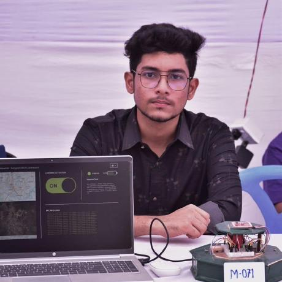
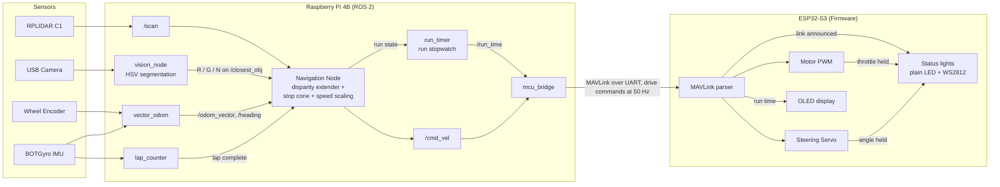
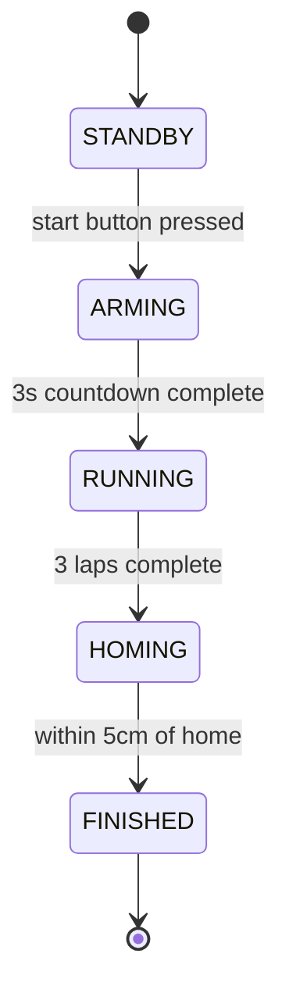
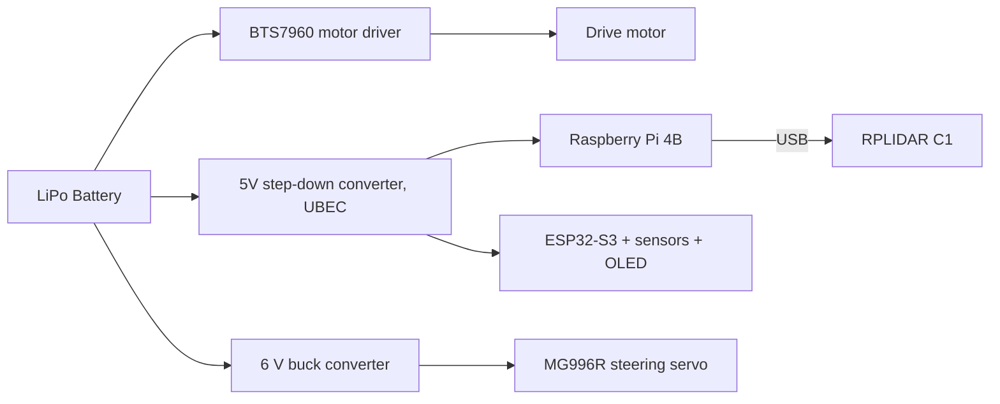
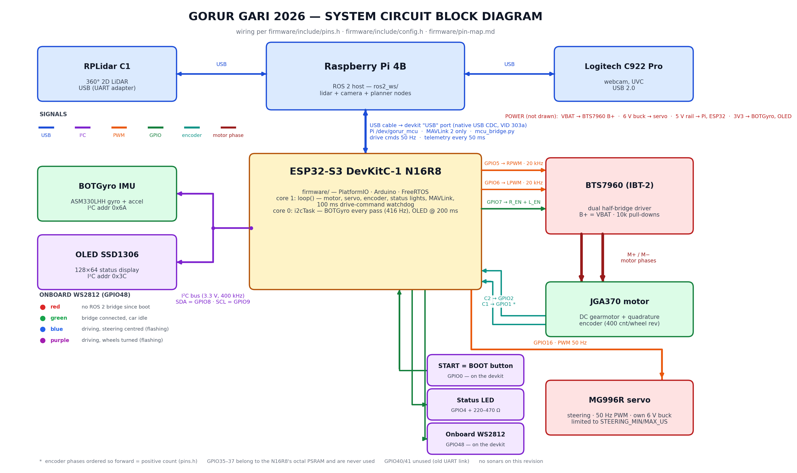
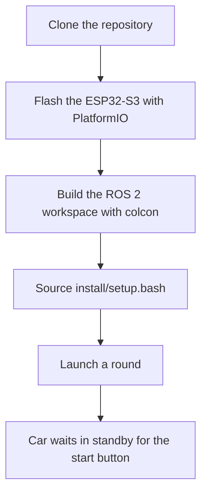

<div align="center">
  
  <!-- Placeholder: add a team banner image at assets/banner.png -->
</div>

**Team Gorur Gari** is a robotics team from Bangladesh, competing in the **Future Engineers** category of the **World Robot Olympiad 2026**. The name means "cow cart" in Bengali. We thought it would be funny to give the most stubbornly traditional vehicle imaginable a LiDAR and teach it to drive itself.

Our car runs a full **ROS 2** stack on a Raspberry Pi, talks to an ESP32-S3 over **MAVLink**, and navigates with a 360-degree LiDAR. If you only have a few minutes, the most interesting parts are probably our [Vector Odometry](#odometry-and-returning-home), the [Disparity Extender](#avoidance-using-lidar) we use for obstacle avoidance, and the way we [detect the traffic pillars with LiDAR and confirm their color with a camera](#obstacle-round).

This repository contains all the code, wiring diagrams, documentation, photos, and everything else about our team and the robot. The narrative behind the design — what we tried, measured, and changed — lives in the [**Engineering Journal**](./ENGINEERING_JOURNAL.md), organized under the same five headings judges score against.

## Judging Criteria Map

For anyone scoring this repository against the WRO Future Engineers rubric — five criteria, each mapped to exactly where the evidence lives:

| Criterion | README | Engineering Journal |
| :-- | :-- | :-- |
| Mobility & Mechanical Design | [§ Mobility and Mechanical Design](#mobility-and-mechanical-design) | [§1](./ENGINEERING_JOURNAL.md#1-mobility-and-mechanical-design) |
| Power & Sensor Architecture | [§ Power and Sensor Architecture](#power-and-sensor-architecture) | [§2](./ENGINEERING_JOURNAL.md#2-power-and-sensor-architecture) |
| Software Architecture & Obstacle Strategy | [§ Algorithm and Software](#algorithm-and-software) | [§3](./ENGINEERING_JOURNAL.md#3-software-architecture-and-obstacle-strategy) |
| Systems Thinking & Engineering Decisions | — | [§4](./ENGINEERING_JOURNAL.md#4-systems-thinking-and-engineering-decisions) |
| Reproducibility & GitHub Quality | [§ Getting It Running](#getting-it-running) | [§5](./ENGINEERING_JOURNAL.md#5-reproducibility-and-github-quality) |

## Table of Contents

- [`Team Introduction`](#team-introduction)
- [`Mission Overview for WRO Future Engineers Rounds`](#mission-overview-for-wro-future-engineers-rounds)
- [`Performance Videos`](#performance-videos)
- [`Repository`](#repository)
- [`Key Features`](#key-features)
- [`Components and Hardware`](#components-and-hardware)
- [`Algorithm and Software`](#algorithm-and-software)
- [`Mobility and Mechanical Design`](#mobility-and-mechanical-design)
- [`Power and Sensor Architecture`](#power-and-sensor-architecture)
- [`Getting It Running`](#getting-it-running)
- [`Submission Checklist`](#submission-checklist)
- [`Acknowledgements`](#acknowledgements)
- [`Engineering Journal`](./ENGINEERING_JOURNAL.md) *(separate document)*

## Team Introduction

<!-- Placeholder: add member photos to the assets folder and fill in the details below -->

<table>
  <tr>
    <td width="33%" align="center">
      <br>
      <strong>Dipanjan Roy Dipro</strong><br>
      Mechanical and CAD Design<br>
      <a href="">[email address]</a>
    </td>
    <td width="33%" align="center">
      <br>
      <strong>Muztahid Rahman</strong><br>
      ROS2, ESP32 Firmware and Electronics<br>
      <a href="mailto:muztahid.rahman@bracu.ac.bd">muztahid.rahman@bracu.ac.bd</a>
    </td>
    <td width="33%" align="center">
      <br>
      <strong>Shayer Mahmud Sowmik</strong><br>
      Vision and Navigation Algorithm<br>
      <a href="mailto:sowmik1337@gmail.com">sowmik1337@gmail.com</a>
    </td>
  </tr>
</table>

## Mission Overview for WRO Future Engineers Rounds

<table>
  <tr>
    <td width="50%" valign="top" align="center"><h3>Round 1: Open Challenge</h3></td>
    <td width="50%" valign="top" align="center"><h3>Round 2: Obstacle Challenge</h3></td>
  </tr>
  <tr>
    <td valign="top">The car has to complete three full laps around the track on its own. The inner walls are placed randomly before the run, so the width of the driving corridor changes from round to round and nothing can be hard-coded. After the third lap the car has to stop where it started.</td>
    <td valign="top">Same track, but now red and green traffic pillars are scattered along the way. The car must pass <strong>red pillars on the right</strong> and <strong>green pillars on the left</strong>, without knocking any of them over, and finish with a parallel parking maneuver in the marked parking zone.</td>
  </tr>
</table>

Both rounds start the same way: the judge says go, we press the start button on the car, and from that moment on nobody touches it.

<!-- ## Performance Videos -->
<!-- 
One public (or link-accessible) YouTube video per challenge is required, each showing at least 30 seconds of actual autonomous driving.

| Round | Link |
| :-- | :-- |
| Open Challenge | `[NEEDS DATA — add YouTube link, ≥30s autonomous driving]` |
| Obstacle Challenge | `[NEEDS DATA — add YouTube link, ≥30s autonomous driving]` | -->

## Repository

This repository includes all the files, designs, and code for our WRO 2026 robot.

### File Structure

Here's a breakdown of the project folders:

- **[`firmware`](./firmware/)**: PlatformIO project for the ESP32-S3. Handles the motor, steering servo, encoder, IMU, OLED display, status lights, and the MAVLink serial link: everything that has to happen in real time.
- **[`ros2_ws`](./ros2_ws/)**: The ROS 2 workspace that runs on the Raspberry Pi. Contains our three packages (`controls`, `autonomy`, and `sensors_processing`) plus launch files and tuning configs.
- **[`mav_msg`](./mav_msg/)**: The MAVLink message definitions (XML) shared between the Pi and the microcontroller, so both sides always agree on what the bytes mean.
- **[`circuit_diagram`](./circuit_diagram/)**: Wiring diagrams and the ESP32 pin map, plus the script that generates them.
- **[`gorusim`](./gorusim/)**: An Ignition Gazebo simulation of the car, built from its CAD and firmware, used **for testing purposes only** and not part of the competition build. Its track tooling is adapted from **Team LazyGo**'s simulator ([`LazyGo_WRO2025`](https://github.com/A-N-M-Noor/LazyGo_WRO2025/)); see [Acknowledgements](#acknowledgements).
- **[`QUICKSTART.md`](./QUICKSTART.md)**: Copy-paste commands for running and debugging each part of the stack.

<!-- Placeholder: add t-photos (team photos) and v-photos (vehicle photos from all six sides) folders before submission -->

## Key Features

- **`Two-brain architecture`**: A Raspberry Pi does the thinking (LiDAR, camera, path planning) while an ESP32-S3 does the doing (motor PWM, servo, encoder counting). Neither one can block the other.
- **`MAVLink instead of raw serial`**: Every packet between the Pi and the microcontroller carries a CRC checksum, so electrical noise from the motor can corrupt a byte without ever corrupting a steering command.
- **`Vector odometry homing`**: The car remembers where it started and drives back to that exact spot after three laps, instead of just reversing for a fixed time and hoping.
- **`LiDAR-first perception`**: Walls, gaps, and even the traffic pillars are found in the laser scan. The camera only answers one question: is that pillar red or green?
- **`Self-healing I2C bus`**: If motor noise knocks the IMU or the display off the I2C bus, the firmware quietly re-initializes them without ever stalling the control loop.
- **`A run clock on the car`**: A dedicated stopwatch node starts the moment the car does, keeps counting through the drive home, and freezes when it parks. The time shows on the car's own OLED, so we can read a run off the robot with no laptop and no stopwatch in anybody's hand.
- **`Removable RC mode for testing`**: A compile-time flag turns the car into a WiFi RC car with a web joystick, which made chassis testing painless. It is fully compiled out of the competition build, where all wireless stays off.

## Components and Hardware

<!-- Placeholder: add component photos to the assets folder and fill in the prices -->

<table>
  <thead>
    <tr>
      <th>Image</th>
      <th>Component</th>
      <th>Role / Function</th>
    </tr>
  </thead>
  <tbody>
    <tr>
      <td><div align="center"></div></td>
      <td>Raspberry Pi 4B</td>
      <td>High-level processing: ROS 2 Humble, LiDAR processing, vision, and path planning.</td>
    </tr>
    <tr>
      <td><div align="center"></div></td>
      <td>ESP32-S3 DevKitC-1</td>
      <td>Real-time control: motor PWM, steering servo, encoder counting, IMU reading, start button (the devkit's own BOOT button), status LEDs, and OLED display. N16R8 module: GPIO35-37 belong to the octal PSRAM and stay unused.</td>
    </tr>
    <tr>
      <td><div align="center"><!-- Placeholder: add a 6N137 optocoupler photo --></div></td>
      <td>6N137 high-speed optocouplers</td>
      <td>Galvanically isolate the serial link between the Raspberry Pi's GPIO UART (<code>/dev/ttyAMA0</code>) and the ESP32-S3's UART1 (GPIO40 TX / GPIO41 RX), which carries MAVLink 2 at 115200 baud. Motor noise on the ESP32 side cannot reach the Pi.</td>
    </tr>
    <tr>
      <td><div align="center"></div></td>
      <td>RPLIDAR C1</td>
      <td>360-degree laser scanner. Our primary sensor for walls, gaps, and pillar detection.</td>
    </tr>
    <tr>
      <td><div align="center"><!-- Placeholder: add a BOTGyro photo --></div></td>
      <td>BOTGyro IMU (ASM330LHH, I2C 0x6A)</td>
      <td>6-axis gyro + accelerometer, read with the <a href="https://github.com/NOXUSTIC/BOTGyro">BOTGyro</a> library. The ESP32 calibrates its zero-rate bias at boot and integrates the yaw rate into the heading; pitch and roll come from the library's complementary filter. There is no magnetometer, so the heading is relative to the start pose and drifts slowly.</td>
    </tr>
    <tr>
      <td><div align="center"></div></td>
      <td>USB HD Camera</td>
      <td>Tells red pillars from green ones. Auto-focus is disabled in software so the image stays sharp while the car moves.</td>
    </tr>
    <tr>
      <td><div align="center"></div></td>
      <td>JGA 370 DC gear motor with quadrature encoder</td>
      <td>Drives the rear axle. The encoder on the motor shaft is what makes our odometry possible.</td>
    </tr>
    <tr>
      <td><div align="center"><!-- Placeholder: add a BTS7960 / IBT-2 photo --></div></td>
      <td>BTS7960 (IBT-2) motor driver</td>
      <td>Dual half-bridge between the microcontroller and the drive motor: RPWM forward, LPWM reverse, both enables tied together.</td>
    </tr>
    <tr>
      <td><div align="center"><!-- Placeholder: add an MG996R photo --></div></td>
      <td>MG996R metal-gear servo</td>
      <td>Turns the front wheels through the Ackermann steering linkage. Powered from its own 6 V buck converter.</td>
    </tr>
    <tr>
      <td><div align="center"></div></td>
      <td>SSD1306 0.96" OLED display</td>
      <td>Shows live status on the car itself, invaluable when there is no laptop connected: motor output, steering angle, drive-command state, encoder count, heading, pitch/roll, IMU state (including "keep still" while it calibrates), and the run stopwatch.</td>
    </tr>
    <tr>
      <td><div align="center"></div></td>
      <td>LiPo battery</td>
      <td>Main power source. [Placeholder: cell count and capacity]</td>
    </tr>
    <tr>
      <td><div align="center"></div></td>
      <td>5V step-down converter (UBEC)</td>
      <td>Regulates battery voltage down to a clean 5V rail for the Pi and the electronics.</td>
    </tr>
  </tbody>
</table>

## Algorithm and Software

ROS 2 underpins our whole control system, letting us split the problem into small nodes that each do one thing. Here is the short version of how sensor data becomes a steering command:



### Two brains, one car

The Raspberry Pi and the ESP32-S3 talk over a UART, the Pi's GPIO UART (`/dev/ttyAMA0`) to the ESP32's UART1 through 6N137 optocouplers, using the **MAVLink 2** protocol with message definitions we wrote ourselves (in [`mav_msg`](./mav_msg/)). We started with plain text serial, and it worked fine until the drive motor was running. Electrical noise would occasionally garble a character, and a garbled steering command is a crashed car. MAVLink frames carry a 16-bit checksum, so a corrupted packet is simply dropped instead of obeyed.

The ESP32's USB port carries nothing but human-readable debug output, so no log line can ever land in the middle of a MAVLink frame (a lesson from the earlier USB link, where one stray I2C error message was enough to desync the parser on the Pi).

**The car moves only while drive commands keep arriving.** After boot the motor stays braked until the first valid drive command, and if no valid one (right message, good CRC) arrives for **100 ms** the firmware brakes at once and centres the steering until the next one. Heartbeats, other messages and corrupted frames never count. `mcu_bridge` re-sends the latest `/cmd_vel` at a fixed **50 Hz** while it is fresh (under 0.3 s old) and stops sending once it goes stale, so a dead bridge, an unplugged cable and a driving node that simply stops all end the same way: the car stops within 100 ms. Four lost frames in a row are tolerated.

### Odometry and returning home

The rules say the car must stop where it started. Instead of guessing with timers, `vector_odom` fuses two signals:

- **Distance**: from the wheel encoder
- **Direction**: from the IMU heading, which the ESP32 integrates from the BOTGyro's yaw rate (relative to the start pose, with a slow drift, since there is no magnetometer)

Each encoder tick is turned into a small displacement vector pointing in the current heading direction, and all the vectors are summed up. At any moment the car knows its position as one straight-line vector from the start point. After the third lap, `open_round_run` simply drives that vector backwards until the car is within **5 cm** of home.

Calibrating this taught us not to trust datasheets. On paper, the encoder gives 1320 counts per revolution. Measured at the actual tick stream, one wheel revolution is **363 counts**, and even then a tape-measure test showed a small residual error we correct with a scale factor of 0.976. Measure everything.

### Open Round

The open round node is a state machine with five states:



- **STANDBY**: Everything is initialized and the LiDAR is spinning, but the node publishes zero velocity. A config flag (`enable_auto_steering`) defaults to *off*, so the car physically cannot move from a bare `ros2 run`. This is a safety habit we picked up after one runaway test.
- **ARMING**: Pressing the start button begins a 3-second countdown while the plain status LED blinks once per second.
- **RUNNING**: The car drives its laps steering toward open space (see the disparity extender below), with a **wall-hugging correction** layered on top. A proportional controller nudges the heading to hold about 35 cm from the outer wall on straights, limited to a 12-degree trim so it can never fight the main steering.
- **HOMING**: Lap counting is done by `lap_counter`, which watches the IMU heading and counts 90-degree corners. Once three laps are in, the node computes the vector back to the start point and drives it, slowing down over the last 60 cm.
- **FINISHED**: The car stops and keeps republishing zero velocity so the microcontroller can never latch onto a stale throttle command.

One small but important trick: when the car starts from standstill, `mcu_bridge` briefly doubles the throttle command for the first second (a "launch boost") to break static friction. Then it hands control back to the normal command. Without it, low-speed starts would sometimes just hum in place.

### Timing the run

The state machine above publishes its state on `/open_round/state`, and a separate node, [`run_timer`](./ros2_ws/autonomy/docs/run_timer.md), does nothing but turn that into a stopwatch: it starts on RUNNING, keeps counting through HOMING (the drive home is part of the run, and the rules time it), and freezes the moment the car reaches FINISHED. The final time appears on the car's OLED as `Time 01:23.4 END`, so after a practice run we read the number off the robot instead of trusting whoever was holding the phone.

Two decisions are worth explaining:

- **It is a separate node, and it commands nothing.** The stopwatch subscribes to one topic and publishes three, none of which is a drive command. Leaving it out of the launch file, or having it crash mid-run, costs a line on the display and changes nothing about how the car drives. Timing is a nice-to-have, and nothing nice-to-have gets to sit near the steering.
- **The state machine publishes on transitions, not just on its 1 Hz heartbeat.** On the heartbeat alone the clock would start somewhere in the second after GO and stop somewhere in the second after the car parks, making every run time wrong by up to a second at each end. Publishing on the transition costs one extra message; on the bench the clock now starts 0.1 ms after the node logs GO.

There is exactly one clock in the system. The microcontroller never counts anything itself: it cannot see the state machine and has no way of knowing when homing has finished, so it is given a number ten times a second and only formats it. If those frames stop arriving, the display says so with a `?` rather than leaving a frozen number that still looks live.

Minutes are the largest unit (`MM:SS.d`) — a WRO run is a few minutes, so an hours field would be two permanently dead characters on a 21-character display line.

### Avoidance using LiDAR

For navigation we use a **disparity extender**: an idea borrowed from F1TENTH racing, tuned for the WRO mat. The intuition is simple: the LiDAR sees a gap, but the car is not a point. It has width. So wherever two neighboring LiDAR rays disagree by more than 25 cm (an "edge", the corner of a wall or a pillar), we extend the closer obstacle sideways in the scan by half the car's width plus a safety margin. After this smearing, any gap that still looks open is *genuinely* open for a car of our size, and we simply steer toward the deepest one.

Two extra guards sit on top:

- A **stop cone**: if anything shows up within 15 cm inside a 20-degree cone dead ahead, the car stops rather than trusting the math.
- **Speed scaling**: the commanded speed drops with the steering angle. From 0.6 m/s on straights down to 0.25 m/s at full lock, so the car never carries straight-line speed into a tight turn.

### Obstacle Round

The traffic pillars are only 5 cm wide, which makes them a distinctive shape in a laser scan. The detector looks for pairs of edges (sudden range jumps) and measures the width of the segment between them. Anything between **3 cm and 25 cm** wide, closer than 2 m, is a pillar candidate. Beyond 2 m, a 5 cm pillar is hit by so few rays it cannot be measured reliably, so we don't try.

The LiDAR tells us *where* the pillar is, but not its color. That's the camera's whole job: `vision_node` segments the image in HSV space and publishes a single character (`R`, `G`, or `N` for nothing) on `/closest_obj`. The navigation node combines the two: red pillar means pass on the right, green means pass on the left. Tiny blobs are ignored so a red banner in the audience cannot steer the car.

Color thresholds shift with venue lighting, so we wrote [`tune_hsv.py`](./ros2_ws/autonomy/autonomy/tune_hsv.py), an interactive tool with sliders that lets us re-tune the HSV ranges at the venue in a couple of minutes.

### Debugging tools

A few things that saved us many hours:

- **RViz configs** ([`ros2_ws/config`](./ros2_ws/config/)): visualize the scan, the detected pillars, and the chosen steering direction live.
- **A debug image topic** from the vision node: showing exactly what the camera thinks is a pillar, bounding boxes and all.
- **The OLED display** on the car: showing status without a laptop, including the run stopwatch, so a practice run is timed and read off the robot itself.
- **The removable RC mode**: for driving the chassis around by hand during mechanical testing.
- **[`gorusim`](./gorusim/)**: a Gazebo simulation of the car, so a navigation change can be tried without a mat, a battery, and a car to pick up off the floor. The chassis comes from the CAD and the real `mcu_bridge` talks to an emulated ESP32 over a virtual serial port, so the autonomy nodes run against it unmodified. Its track tooling is adapted from **Team LazyGo**'s simulator ([`LazyGo_WRO2025`](https://github.com/A-N-M-Noor/LazyGo_WRO2025/)) and it exists **purely for testing**: nothing in it ships on the competition car.

## Mobility and Mechanical Design

### The chassis

The car is a four-wheeled, rear-wheel-drive design with front-wheel Ackermann steering. This is the same layout as a real car, and the layout the rules effectively require (no differential drive, no omni wheels, both rear wheels on one physically coupled axle).

| Parameter | Value |
| :--- | :--- |
| Length | 210 mm |
| Width | 120 mm |
| Height | [Placeholder] |
| Weight | [Placeholder] |

<!-- Placeholder: add chassis/CAD photos here -->

### Drive motor and gearbox

A single DC gear motor drives the rear axle. We drive it through a BTS7960 (IBT-2) dual half-bridge at a **20 kHz PWM frequency** (above the audible range), which got rid of the annoying motor whine at low speeds and noticeably smoothed out low-speed torque, which matters for the parking maneuver. RPWM drives forward and LPWM reverse; the firmware always lowers one before raising the other, ramps the output (500 %/s by default) so a change of direction passes through a brake, and maps the full throttle command onto the full duty range.

The quadrature encoder sits on the motor shaft, before the gearbox, so it gets multiple counts per degree of wheel rotation, plenty of resolution for odometry.

One detail worth confessing: the encoder's A and B channels are wired *opposite* to the board's silkscreen. On purpose. Wired "correctly", the decoder counted down when the car drove forward, which flipped the sign of every distance in the odometry. Swapping the pins in [`pins.h`](./firmware/include/pins.h) was cleaner than negating values in three different places.

### Steering

An MG996R metal-gear servo, on its own 6 V supply, drives the front steering linkage. The firmware treats a commanded 90 degrees as straight ahead and maps the 0-180 command onto three calibrated pulse widths (`STEERING_MIN_US`, `STEERING_CENTER_US`, `STEERING_MAX_US` in [`config.h`](./firmware/include/config.h)), so the servo can never be driven into the linkage's end stops, no matter what the navigation node asks for.

The drive wheel diameter is deliberately a launch parameter rather than a constant: we measure the wheels before a run, because a millimeter of error in diameter compounds into centimeters of odometry error over three laps.

## Power and Sensor Architecture

### Power distribution

Everything runs off a single LiPo battery, split into separate rails so the noisy loads cannot brown out the sensitive ones:



The important decision here: the drive motor draws directly from the battery through its own driver, while everything digital lives behind the regulator. When the motor stalls or the servo hits its end stop, the current spike stays on the battery side of the converter.

### Voltage Distribution Table

<!-- Placeholder: verify these values against the final wiring -->

| Component | Voltage supplied | Power source / converter |
| :--- | :--- | :--- |
| Raspberry Pi 4B | 5V | Step-down converter (UBEC) |
| RPLIDAR C1 | 5V | Raspberry Pi USB port |
| ESP32-S3 | 5V | Step-down converter (UBEC) |
| Steering servo (MG996R) | 6V | Its own buck converter |
| Drive motor | Battery voltage | BTS7960, direct from battery |
| BOTGyro, OLED | 3.3V | ESP32-S3 board regulator |

### Sensors and where they sit

- **RPLIDAR C1**: mounted centered over the chassis, high enough that the scan plane clears the walls' lip and wiring but still sees the 10 cm tall traffic pillars. It streams to the Pi over USB at 460,800 baud.
- **BOTGyro IMU**: mounted flat with its Z axis up, near the car's center of rotation, so cornering forces do not contaminate the heading. It shares the ESP32's I2C bus (400 kHz) with the OLED. If it is ever mounted upside down, flip `IMU_YAW_SIGN` in `config.h`: the heading must grow when the car turns clockwise.
- **USB camera**: front-facing with a slight downward tilt so pillars fill the frame at the distances that matter. Continuous auto-focus is turned off with `v4l2-ctl` before every run, because a lens that hunts for focus mid-corner produces exactly the blurry frame you least want.
- **Wheel encoder**: on the motor shaft, feeding the ESP32's pulse counter.
- **Sonars**: none on this hardware revision. The LiDAR made them redundant, and their old GPIOs now belong to the steering servo and the Pi UART. The telemetry message keeps its four sonar fields, which always report "no reading".
- **Start button and status LEDs**: the entire competition interface. One button to start, and two lights to show what state the car is in. The start button is the devkit's own **BOOT button** (GPIO0): a strapping pin, so the firmware only ever reads it, after boot, debounced for 30 ms. The plain LED (GPIO4) answers the one question that matters during bring-up, "is the Pi talking to the microcontroller", and blinks out the 3-second start countdown. It also blinks fast while the IMU calibrates (keep the car still) and gives a short blip every second if the IMU is missing or faulted. The devkit's onboard WS2812 pixel repeats that in colour and adds the drivetrain: **red** until the Pi announces itself, **green** once connected and standing still, **flashing blue** while the motor drives straight, **flashing purple** while it drives with the wheels turned. Driving outranks the link colour, so a car that is moving never shows a resting colour — a stale throttle the ROS2 side is no longer refreshing still reads as motion, which is exactly the state you want to catch on a bench. The pixel is already soldered to the devkit, so this second light costs no wiring and no pin: `firmware/lib/rgb_status_led` drives it through the Arduino core's `neopixelWrite()` instead of pulling in a pixel library.

The full wiring is documented in [`circuit_diagram`](./circuit_diagram/) and the exact pin assignments in [`firmware/pin-map.md`](./firmware/pin-map.md) (ESP32-S3-DevKitC-1 N16R8):

| Function | GPIO | Notes |
| :-- | :-- | :-- |
| BTS7960 RPWM (forward PWM) | 5 | 20 kHz, 10k pull-down on board |
| BTS7960 LPWM (reverse PWM) | 6 | 20 kHz, 10k pull-down on board |
| BTS7960 R_EN + L_EN (tied) | 7 | 10k pull-down on board |
| Steering servo (MG996R) signal | 16 | 50 Hz, servo powered from a separate 6 V buck |
| Encoder C1 / C2 | 1 / 2 | quadrature, 3.3 V |
| I2C SDA / SCL | 8 / 9 | BOTGyro 0x6A, SSD1306 OLED 0x3C |
| Start button = the devkit's BOOT button | 0 | INPUT_PULLUP, active low, read only after boot |
| Status LED | 4 | plain LED, active high |
| UART to the Raspberry Pi (via 6N137) | TX 40, RX 41 | Serial1, 115200 8N1, Pi side `/dev/ttyAMA0` |
| Onboard WS2812 status pixel | 48 | soldered to the devkit |

<div align="center">
  
</div>

### When things go wrong

We spent a lot of time on the boring failure cases, because a robot that works 9 runs out of 10 loses on the 10th:

- **I2C lockups**: Motor noise can hang the bus mid-run, and a sensor can still be in its own power-on reset when the firmware first looks for it. All I2C work runs in its own task on the second core, so a slow or failing device can never hold up steering, throttle or the drive timeout. A missing IMU is retried every 3 s, a faulted one is re-initialised every second, the OLED is re-initialised if it stops answering, and if the gyro keeps failing at 400 kHz the whole bus drops to 100 kHz. The IMU state is shown on the OLED and the LED and reported to the Pi as a MAVLink status text, and the car stays drivable throughout.
- **Stale commands**: If no valid drive command arrives for 100 ms, for any reason (bridge crashed, cable unplugged, driving node stopped), the firmware brakes and centres the steering rather than continuing at the last known throttle.
- **Moving during IMU calibration**: Drive commands are ignored for the first moments after boot, until the gyro has measured its bias (at most 5 s), so the car is guaranteed to be standing still while it does.
- **Button bounce**: The start button is debounced in firmware, so one press means exactly one start.
- **No wireless, provably**: WiFi and Bluetooth are disabled in the competition firmware build (the RC test mode is excluded at compile time), and the Pi's radios are switched off, as the rules require.

## Getting It Running

You need Ubuntu 22.04 with **ROS 2 Humble**, plus **PlatformIO** for the firmware.



**1. Clone the repository**

```bash
git clone https://github.com/muztahiddurjoy/gorur_gari_2026.git
cd gorur_gari_2026
```

**2. Flash the ESP32-S3**

```bash
cd firmware
pio run --target upload
```

**2b. Enable the Pi's GPIO UART** (once per Pi). The ESP32 link is `/dev/ttyAMA0`. On a Pi 4 that is only the GPIO UART once Bluetooth is moved off it, and the Linux serial console must not be using it:

```bash
# /boot/firmware/config.txt (on older images /boot/config.txt), then reboot
enable_uart=1
dtoverlay=disable-bt
# and turn the serial login console off (keep the serial hardware on):
sudo raspi-config   # Interface Options -> Serial Port -> login shell: No, hardware: Yes
sudo usermod -aG dialout $USER
```

**3. Build the ROS 2 workspace**

```bash
cd ../ros2_ws
rosdep install --from-paths . --ignore-src -r -y
colcon build --symlink-install
source install/setup.bash
```

**4. Launch a round**

```bash
# Open Challenge
ros2 launch launch/gorurgari_open_round.launch.py

# Obstacle Challenge
ros2 launch launch/gorurgari_obstacle_round.launch.py
```

After launch the car sits in standby until the start button on the car is pressed. All tuning lives in [`ros2_ws/config/bot_config.yaml`](./ros2_ws/config/bot_config.yaml): one file, commented, no magic numbers buried in code. For bench testing, every driving node has an enable flag that defaults to off, so nothing moves unless you explicitly ask it to. More copy-paste commands for individual nodes and debugging tools are in [`QUICKSTART.md`](./QUICKSTART.md).

**Optional: running it in simulation.** If you don't have the car in front of you, [`gorusim`](./gorusim/) will run the same autonomy nodes against a simulated one. It is a **testing tool only** and takes no part in a competition run. See [`gorusim/README.md`](./gorusim/README.md) for the build and launch commands.

## Submission Checklist

WRO Future Engineers scores this repository (primary source) plus a hardcopy of the [Engineering Journal](./ENGINEERING_JOURNAL.md) brought to the international final as an offline fallback. Required repository contents, and what's outstanding:

| Required | Status |
| :-- | :-- |
| README ≥ 5000 characters, in English | Done |
| All source code, commented, readable as plain text | Done |
| CAD / STL / laser / CNC files | `cad_files/` exists but is currently **empty** — add exports here |
| Wiring diagrams | Done — [`circuit_diagram/`](./circuit_diagram/) |
| Photos: every side, top, bottom, plus a team photo | Placeholders reference `./assets/`, but that folder does **not yet exist** — add it with real photos |
| YouTube links, one per challenge, ≥30s autonomous driving | Outstanding — see [Performance Videos](#performance-videos) |
| Discussion of mobility, power and sense, obstacle management | Done — see the [Judging Criteria Map](#judging-criteria-map) |
| Engineering Journal, structured around the 5 scoring criteria | Done — [`ENGINEERING_JOURNAL.md`](./ENGINEERING_JOURNAL.md) |

Commit and publication deadlines are hard cutoffs, not soft targets — anything pushed after the required "2 weeks before" commit may not count toward the score. The full schedule (commit 1/2/3, repo-link submission, hardcopy, and the 12-month public-repo requirement) is tracked in the [Engineering Journal § Reproducibility and GitHub Quality](./ENGINEERING_JOURNAL.md#5-reproducibility-and-github-quality).

## Acknowledgements

- **[Team LazyGo](https://github.com/A-N-M-Noor/LazyGo_WRO2025/)** — the track tooling in our simulator, [`gorusim`](./gorusim/), is taken from their WRO 2025 repository [`LazyGo_WRO2025`](https://github.com/A-N-M-Noor/LazyGo_WRO2025/). We use it **for testing purposes only**; none of it runs on the competition car. The circle-cast ray marching at the core of our navigation nodes also comes from their work, as noted in the source. Thanks to them for publishing it.
- **The F1TENTH community** — for the disparity extender idea our obstacle-round navigation is built on.

---

*Built by Team Gorur Gari for the World Robot Olympiad 2026, Future Engineers category.*
