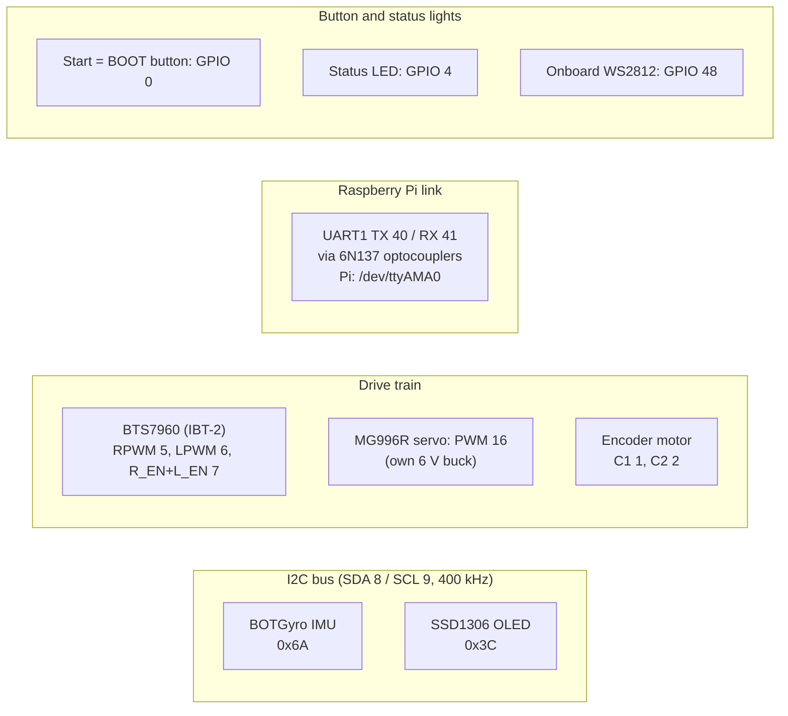

# ESP32-S3 pin map

Board: **ESP32-S3-DevKitC-1 N16R8**. The octal PSRAM on this module uses **GPIO35-37**, so none of them may be used. Every pin below is defined in [`include/pins.h`](./include/pins.h); every timing and limit is in [`include/config.h`](./include/config.h).

## Overview by subsystem

## Full table

| Function | GPIO | Notes |
| --- | --- | --- |
| BTS7960 RPWM (forward PWM) | **5** | 20 kHz, 8-bit; 10k pull-down on the board |
| BTS7960 LPWM (reverse PWM) | **6** | 20 kHz, 8-bit; 10k pull-down on the board |
| BTS7960 R_EN + L_EN (tied) | **7** | 10k pull-down on the board |
| Steering servo (MG996R) signal | **16** | 50 Hz; the servo is powered from a separate 6 V buck, only signal + ground come from the ESP32 |
| Encoder C1 / C2 | **1 / 2** | quadrature, 3.3 V (A and B deliberately swapped vs. the silkscreen, see `pins.h`) |
| I2C SDA / SCL | **8 / 9** | `Wire.setPins(8, 9)` before `Wire.begin()`; BOTGyro 0x6A (0x6B if SA0 high), SSD1306 OLED 0x3C |
| Start button = the devkit's BOOT button | **0** | INPUT_PULLUP, active low, 30 ms software debounce |
| Status LED | **4** | plain LED, GPIO -> 220-470 R -> anode, cathode to GND |
| UART to the Raspberry Pi (6N137 optocouplers) | **TX 40, RX 41** | Serial1, 115200 8N1; Pi side `/dev/ttyAMA0` |
| Onboard WS2812 status pixel | **48** | soldered to the devkit (`RGB_BUILTIN`) |

GPIO35, 36 and 37 are the octal PSRAM's. The native USB port (GPIO19/20) is used for debug output only.

## Notes

### Motor driver (BTS7960)

`MotorController` (`lib/motor_control`) drives RPWM and LPWM as two ESP32PWM (LEDC) channels at 20 kHz and the tied enables as a plain output:

| State | RPWM | LPWM | EN |
| --- | --- | --- | --- |
| Forward | duty | 0 (written first) | HIGH |
| Reverse | 0 (written first) | duty | HIGH |
| Brake | 0 | 0 | HIGH |
| Coast | 0 | 0 | LOW |

The two PWM pins are never both non-zero. The output is ramped at `MOTOR_SLEW_PERCENT_PER_S`, and a change of direction always passes through a brake. The safety stop bypasses the ramp. The int8 throttle on the wire maps +/-127 to full duty.

### Steering servo

The 0-180 steering command (90 = straight) is mapped onto `STEERING_MIN_US` / `STEERING_CENTER_US` / `STEERING_MAX_US`, and nothing outside MIN..MAX is ever sent. **Calibrate those three on the bench before driving.** The defaults are a conservative +/-400 us around 1500 us.

### PWM timers

`setup()` calls `ESP32PWM::allocateTimer(0..3)` before anything attaches, so ESP32PWM gives each frequency its own LEDC timer: the two 20 kHz motor channels share one, and the 50 Hz servo never lands on it. ESP32Servo 3.x actually drives the servo from MCPWM on the S3, which keeps them apart in any case.

### Start button on GPIO0

GPIO0 is a strapping pin. The firmware only reads it, after boot, with the internal pull-up, and never drives it. Nothing else may be wired to it. Holding BOOT through a reset still enters the ROM bootloader, as on any devkit.

### Status LED (GPIO4)

Priority order:

1. The start countdown: after a start button press, three blinks, once a second.
2. IMU patterns: a fast 5 Hz blink while the gyro calibrates (keep the car still), or a short blip once a second if the IMU is missing, faulted or uncalibrated.
3. The link level: lit once the ROS 2 bridge has announced itself, then whatever `mcu_bridge`'s `/status_led` topics ask for.

### Onboard WS2812 (GPIO48)

It is soldered to the devkit, so it costs no wiring. It repeats the link state in colour and adds what the drivetrain is doing, which the single plain LED cannot show:

| Colour              | Meaning                                                    |
| ------------------- | ---------------------------------------------------------- |
| Red                 | No ROS2 bridge has announced itself since boot              |
| Green               | Bridge connected, drivetrain idle                           |
| Flashing blue       | Motor driving, steering within a couple of degrees of centre |
| Flashing purple     | Motor driving with the wheels turned                        |

Driving outranks the link colour, because wheels turning is the thing worth spotting from across the table and the link state is on the plain LED anyway. Reverse counts as driving. Brightness, flash period and the "centred" tolerance are in `firmware/include/config.h`. The driver is `firmware/lib/rgb_status_led`, which uses the Arduino core's RGB LED call (RMT) rather than a pixel library.

Both lights follow the same one-shot connect message, so read red as "never connected since boot" rather than "not connected right now". The OLED's `Cmd:` line shows whether drive commands are arriving *now*.

Some ESP32-S3-DevKitC-1 revisions route the pixel to a different GPIO. `RGB_STATUS_LED_PIN` in `firmware/include/pins.h` follows the board variant's `RGB_BUILTIN` and is the one place to change it.

### Link to the Pi

UART1 at 115200 8N1 on GPIO40 (TX) / GPIO41 (RX), through 6N137 optocouplers to the Pi's GPIO UART (`/dev/ttyAMA0`), carrying MAVLink 2. The car moves only while valid drive commands keep arriving: after 100 ms without one (`CMD_TIMEOUT_MS`) the motor brakes and the steering centres. `mcu_bridge` sends them at 50 Hz while `/cmd_vel` is fresh.

If no frame ever gets through, check the optocoupler polarity. A 6N137 stage can invert the signal depending on how its LED side is wired, and a UART needs to idle high on both ends.
