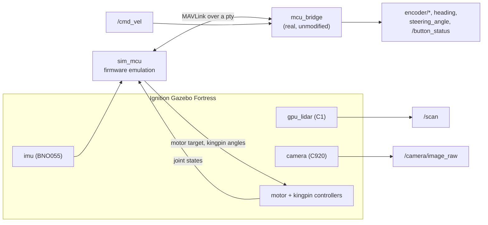

# gorusim

> **Credit and scope.** The track tooling here (`track_maker`, the pillar and wall templates) is adapted from **Team LazyGo**'s simulator, published at [github.com/A-N-M-Noor/LazyGo_WRO2025](https://github.com/A-N-M-Noor/LazyGo_WRO2025/). The car itself is built from our own CAD and firmware. It is here **for testing and development purposes only**: a bench tool for exercising the autonomy stack without the physical car, not part of the competition vehicle or its run.

This is the Gorur Gari 2026 car, simulated in Ignition Gazebo Fortress. Everything physical comes from [`CAD/WRO_Bot_v2.step`](../CAD/WRO_Bot_v2.step), and everything electronic comes from [`firmware/`](../firmware/). The driving stack runs its real code with its real config: the real `mcu_bridge` is in the loop, talking MAVLink over a virtual serial port to an emulated ESP32. Nothing downstream knows it is a simulation.

## Data flow



## Running it

```bash
cd <repo>
colcon build --base-paths gorusim ros2_ws \
             --build-base ros2_ws/build --install-base ros2_ws/install \
             --symlink-install
source ros2_ws/install/setup.bash

ros2 launch gorusim open_round_sim.launch.py        # three laps on the bare mat, then home
ros2 launch gorusim obstacle_round_sim.launch.py    # with traffic pillars
ros2 launch gorusim sim.launch.py                   # simulator only, drive it yourself
```

| Argument | Default | What it does |
| :-- | :-- | :-- |
| `gui` | `true` | `false` runs the server headless |
| `rviz` | `true` | Opens RViz |
| `enable_auto_steering` | `true` | `false` plans without moving the car |
| `require_button_start` | `false` | `true` waits for the start button |
| `track_config` | `track_open.yaml` (open), `track.yaml` (obstacle) | Pillar, parking, and start layout |
| `world` | `goruWorld` | Only on `sim.launch.py`. `flatWorld` is an open floor for measuring dynamics |

To drive it by hand (`angular.z > 0` steers left, as the stack assumes; the throttle maps as on the car, so `linear.x` is not m/s):

```bash
ros2 topic pub -r 20 /cmd_vel geometry_msgs/msg/Twist \
    '{linear: {x: 1.25}, angular: {z: 0.3}}'
```

Press the start button with:

```bash
ros2 service call /gorusim/press_start std_srvs/srv/Trigger
```

That also starts the 3 × 1 s countdown blink on the status LED, as on the car.

### Status LED

The LED is the green bead above the car in RViz (display `StatusLed`). It is dark
until `mcu_bridge` connects, then lit. Any node can control it through `mcu_bridge`,
the same way it works on the real car:

```bash
ros2 topic pub --once /status_led std_msgs/msg/Bool '{data: false}'          # steady off
ros2 topic pub --once /status_led std_msgs/msg/Bool '{data: true}'           # steady on
ros2 topic pub --once /status_led/blink std_msgs/msg/Float32 '{data: 2.0}'   # blink at 2 Hz
ros2 topic pub --once /status_led/blink std_msgs/msg/Float32 '{data: 0.0}'   # stop blinking
ros2 topic echo /gorusim/status_led                                         # what the LED shows
```

There is no LED message on the wire. Both topics are sent as the connect frame, so on
the car the RGB pixel also goes red/green with every toggle. While the start countdown
is blinking, a command only changes the level the LED goes back to when the countdown ends.

## Where every number comes from

**Measured from the STEP** by [`tools/extract_cad.py`](tools/extract_cad.py), which writes `description/cad_generated.xacro`, `config/cad_geometry.yaml` and `meshes/`:

| | Value | Taken from |
| :-- | :-- | :-- |
| Wheelbase | 140 mm | wheel axle cylinders |
| Track, front and rear | 107 mm | tread centres |
| Tyre | Ø53 × 12 mm | outermost cylinder of each wheel |
| Kingpins | ±29.75 mm, 23.75 mm inboard of the wheel plane | bores in the front wheel holder |
| Steering arms | 20 mm, leaning in 12° | tie bar pins to kingpins |
| Servo horn, rod | 10 mm, 34.12 mm | horn boss and rod ball centres |
| Rear axle | one solid shaft, 1:1 spur gears to the motor | rear_shaft, the 23-tooth gear pair |
| LiDAR | 76 mm ahead of `base_link`, scan plane 68.25 mm up, hung under the third deck | C1 body and optical window |
| Camera | 120 mm ahead, 127 mm up, level, on a fixed arm | C920 lens glass |
| IMU | on the perfboard stack, near mid wheelbase | GY-BNO055 breakout |
| Mass properties | per link, integrated over the solids | volumes × the assumptions below |

`base_link` is the CAD origin: on the ground, midway between the axles.

**Behaviour from the firmware**, emulated in [`gorusim/sim_mcu.py`](gorusim/sim_mcu.py), with the constants checked against `firmware/` by the tests:

| | Value | Source |
| :-- | :-- | :-- |
| Throttle | duty = \|wire\| / 255, so full-scale int8 is under 50% | `motor_control.cpp`, 8-bit PWM |
| Steering | `servoCorrection = 23`: horn travel −67° .. +90° about centre | `steering_control.h` |
| Telemetry | 50 ms | `SENSOR_TX_INTERVAL_MS` |
| Encoder rpm | 50 ms samples over 400 counts | `ENCODER_COUNTS_PER_REV` |
| Heading | 0..360°, clockwise, zero at power-on | `heading.cpp` |
| Drive watchdog | none: the last throttle stays latched | `main.cpp` |

**Behaviour from the driver and datasheets:** RPLIDAR C1 at 10 Hz, 0.05–12 m, ±30 mm, on `rplidar_ros`'s 720-ray grid from −179° to +180°. BNO055 at 100 Hz. MG996R at 0.17 s/60°. C920 at 640×480 with `camera_hfov_deg` from `vision_params.yaml`.

**Configuration is the real files.** `config/bot_config.yaml`, `vision_params.yaml` and `disparity_extender_params.yaml` are symlinks into `ros2_ws/config`, and the launch files pass the same `vector_odom` and `lap_counter` values as the real launch files. [`config/sim_overlay.yaml`](config/sim_overlay.yaml) is the complete list of what the simulator overrides: the serial port, and waiting for the track to be laid out.

**Derived:** with no real data to fit, the steering's full travel works out as:

| Command | Wheels (inner / outer) | Stopped by |
| :-- | :-- | :-- |
| Full left (wire 158 and up) | 37.3° / 31.0° | Outer tyre touching the chassis |
| Full right (wire 23 and below) | 30.9° / 26.7° | Servo end of travel, from `servoCorrection` |

### Not measured: please replace these

The repo has no data for these, so they are typical values. Each is in one place, so measuring the car fixes it there:

| | Assumed | Where | Effect if wrong |
| :-- | :-- | :-- | :-- |
| Total mass | 1212 g, from volumes × densities and datasheet weights | `MASS_RULES` in `tools/extract_cad.py`. Weigh the car, then re-run with `--total-mass-g` | Acceleration, cornering |
| Motor no-load speed | 98.3 rad/s at full duty | `description/control.xacro`, `config/sim_hardware.yaml` | Every speed and lap time |
| Motor stall torque | 0.20 N·m at the axle | `description/control.xacro` | Acceleration, whether it stalls in corners |
| Friction | 0.015 N·m rolling, breakaway at 15% duty | `description/control.xacro`, `config/sim_hardware.yaml` | Creep speeds, stalling |
| Tyre grip | μ = 1.0 | `description/gazebo.xacro` | Cornering, solid axle scrub |
| Camera tilt | 0°, as modelled in CAD (the README mentions a slight tilt) | `camera_pitch` in `description/goruBot.xacro` | Where pillars sit in the frame |

## Checking it

```bash
python3 -m pytest gorusim/test

# with the simulator up on the open floor, and nothing else driving:
ros2 launch gorusim sim.launch.py gui:=false rviz:=false build_track:=false world:=flatWorld
python3 gorusim/tools/verify_dynamics.py
```

## Things worth knowing

**The car's own parts are in the scan.** The scan plane is above the bumper and wheels but cuts through the standoffs and the Pi's connectors behind the scanner, so the rear arc has around 110 rays under 0.3 m. The real scanner sees those too. The front ±80° is clear.

**`mcu_bridge` must start after `sim_mcu`.** It opens the port once at startup, so the launch file waits for the virtual ESP32, just as you would plug in the USB cable first.

**Surfaces need `laser_retro`.** `open_round_run.ray_valid()` discards any ray with intensity at or below 0.05, and Ignition returns zero for a surface with no `laser_retro`. A new obstacle without one is invisible to navigation, even though its range comes back correctly.

**The C1's optical window is left out of its visual mesh.** The beam starts inside the housing, and `gpu_lidar` reports no return for a ray whose first surface is under `range_min`. With a solid belt there, the scanner is blind in every direction.

**Pillar colours are not decorative.** `vision_params.yaml` thresholds red at `S = 255` exactly, so the pillars render with zero green and blue and a black specular term.

**Don't set `use_velocity_commands` on the steering.** In Fortress that mode feeds the position error back with the wrong sign, and the kingpins run to their stops while the command topic still reads correct.

**`vision_node` runs with `PYTHONNOUSERSITE=1`.** ROS Humble's `cv_bridge` is built against NumPy 1.x, and a NumPy 2 in `~/.local` makes the node segfault, so the launch file puts it on the system packages.

**The steering linkage is static in the visuals.** The horn, rod and tie bar are part of the chassis mesh and do not move on screen. Their kinematics are fully modelled in `gorusim/linkage.py`, and the knuckles and wheels do move.

## Layout

```
config/
  bot_config.yaml, vision_params.yaml,
  disparity_extender_params.yaml   symlinks to the real ros2_ws/config files
  sim_overlay.yaml      everything the simulator overrides in them
  sim_hardware.yaml     constants for the emulated ESP32
  cad_geometry.yaml     generated from the STEP
  track.yaml            pillar / parking / start layout
  track_open.yaml       the bare mat
  object_template.sdf, wall_template.sdf
  goruSim.rviz
description/
  goruBot.xacro         entry point
  cad_generated.xacro   generated: dimensions, masses, inertias, visuals
  goruBotCore.xacro     chassis, solid rear axle, steered corners, collisions
  control.xacro         motor equation, kingpin controllers, joint states
  lidar.xacro, IMU.xacro, camera.xacro, gazebo.xacro
gorusim/
  sim_mcu.py            the emulated ESP32
  linkage.py            servo horn -> rod -> tie bar -> knuckles
  track_maker.py        lays out the mat
launch/
  sim.launch.py, open_round_sim.launch.py, obstacle_round_sim.launch.py
meshes/                 generated from the STEP
tools/
  extract_cad.py        STEP -> meshes, masses, geometry
  steering_lock.py      where the tyres hit the chassis
  verify_dynamics.py    drives the car and checks it against the numbers
worlds/
  goruWorld.sdf         the mat
  flatWorld.sdf         an open floor, for verify_dynamics.py
```

`CAD/gorusim_collision.step` is the simplified convex model behind the collision shapes in `goruBotCore.xacro`.
